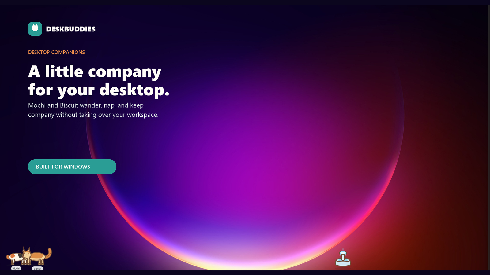
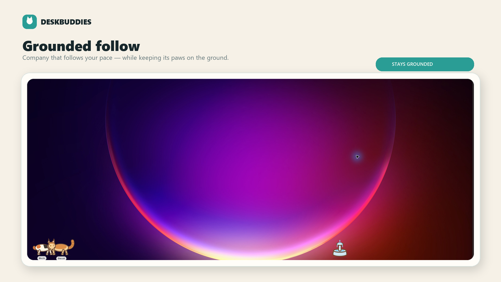
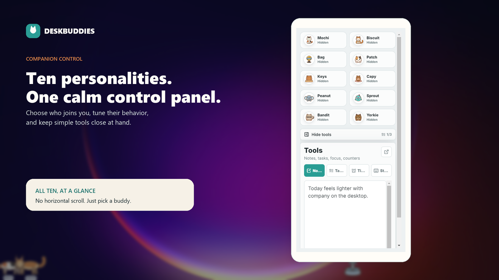
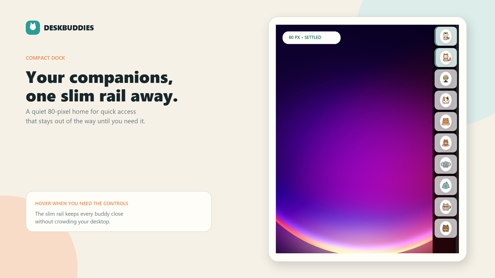
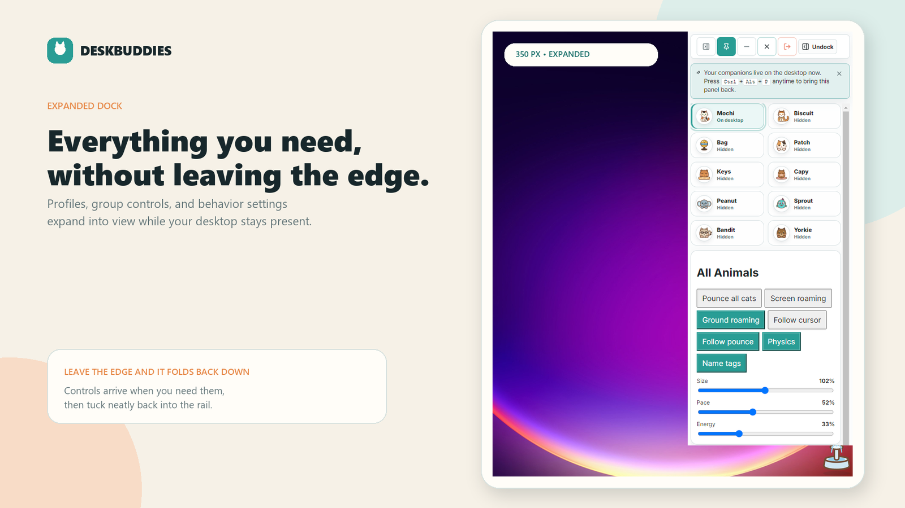
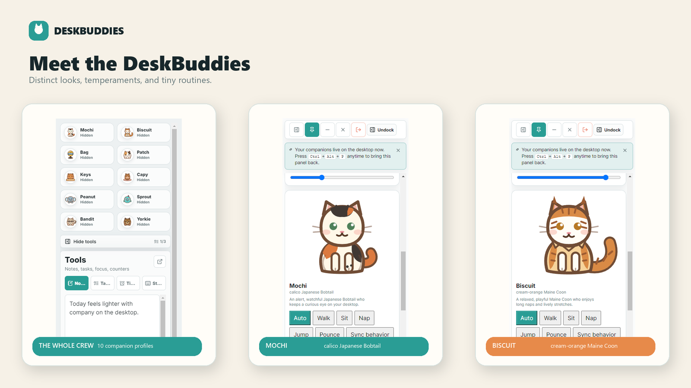

# DeskBuddies 🐱

Little hand-drawn companions that wander around your desktop, nap near the
taskbar, watch your cursor, and occasionally tear across the screen for no good
reason.

Mochi is a watchful calico Japanese Bobtail. Biscuit is a sleepy cream-orange
Maine Coon. They live in a transparent desktop overlay, along with eight other
cats, dogs, critters, and weird little objects you can summon from the panel.



[Watch the full showcase](showcase/exports/video/deskbuddies-showcase-1080p.mp4) ·
[Watch the silent UI demo](showcase/exports/video/deskbuddies-ui-demo-silent.mp4)

## Why?

I wanted a desktop pet that actually felt alive — not a static sprite that sits
in the corner, but something that wanders, reacts, and has a bit of personality.
Most desktop pet apps I found were either abandoned Java applets from 2004 or
bloated Electron apps with a million dependencies and no soul.

So I built one. Yes, it is also an Electron app. The pets are custom SVG rigs
animated with CSS, though: no canvas, no WebGL, no game engine, and no pile of
sprite sheets.

## What they do

- **Roam and react.** Companions walk, sit, nap, stretch, watch, jump, pounce,
  climb, and get the occasional case of zoomies. Click one for a heart or drag
  it somewhere better.
- **Have actual personalities.** Each companion has different weighted behavior
  preferences. Mochi watches more. Biscuit naps more. Capy is exactly as busy as
  you would expect a capybara to be.
- **Follow without floating around.** Follow Cursor can be switched on or off at
  any time. Grounded follow keeps the pets on the floor while they chase the
  cursor horizontally; screen roaming lets them use more of the desktop.



- **Hang out together.** Nearby resting cats can greet and cuddle. Biscuit also
  wanders over to the fountain for a drink.
- **Stay out of the way.** The transparent overlay passes normal clicks through
  to the desktop and only becomes interactive around a pet or draggable prop.

## The panel



The two-column companion selector fits the full crew without a horizontal
scroll strip. Click a profile to summon or hide it, or drag its portrait onto the
desktop. Each summoned companion gets its own controls for:

- Auto, Walk, Sit, Nap, Jump, Pounce, and Sync Behavior
- size, pace, and energy
- group pouncing, screen or ground roaming, follow, follow-pounce, physics, and
  name tags

There are also small built-in tools for notes, tasks, a focus timer, and basic
activity stats. Notes, tasks, and the timer can pop out into their own windows.

### Docking and window controls

Drag the panel to the left or right edge of a display and it docks into a compact
rail. Hover over it or move keyboard focus into it to expand; leave it and it
folds away again after a short delay. A manual collapse stays collapsed until
you deliberately leave and come back, so it does not instantly reopen under the
same cursor. You can also dock left or right from the panel controls and undock
from the dock header.



Move the cursor over the docked rail — or tab keyboard focus into it — and it
slides out to the full panel:



Leave the expanded dock and it folds back into the rail after a short delay. A
manual collapse stays collapsed until you deliberately leave and come back, so
it does not instantly reopen under the same cursor. You can also dock left or
right from the panel controls and undock from the dock header.

The title bar has separate actions because they are not the same thing:

- **Minimize** minimizes the panel.
- **Hide** sends the panel to the tray while the companions keep roaming.
- **Quit** exits DeskBuddies. A running focus timer gets a confirmation first.

Double-click the tray icon, choose **Show panel**, or press `Ctrl+Alt+P` to bring
the panel back. The tray also has a reversible Follow mode checkbox and a real
Quit command.

## Companions

| Name | What are they? | General disposition |
|---|---|---|
| Mochi | Calico Japanese Bobtail | Alert, curious, and usually watching |
| Biscuit | Cream-orange Maine Coon | Relaxed, playful, and very good at naps |
| Yorkie | Yorkie terrier | Small, alert, and ready to move |
| Capy | Capybara | Maximum chill |
| Peanut | Tiny elephant | Gentle and unhurried |
| Bandit | Ringtail buddy | Curious raccoon business |
| Sprout | Tiny horn blob | Fast, bouncy, and a little chaotic |
| Patch | Patch cat | Spotted and easygoing |
| Keys | Keyboard buddy | A cat with an extremely specific seat |
| Bag | Training buddy | A punching bag. It mostly stands there. |



## Run it locally

DeskBuddies currently targets Windows. You will need Node.js 18 or newer and
npm.

```powershell
npm install
npm run dev
```

`npm run dev` starts the Vite server and Electron together. DeskBuddies opens
the panel and the transparent pet overlay as separate windows.

Useful commands:

```powershell
npm test          # run the 271-test Vitest suite
npm run build     # type-check, then build the renderer into build-output/
npm run preview   # preview the renderer without Electron
npm run dist      # build Windows NSIS and portable packages into release/
npm run dist:stager  # shipping lane: stage the Rust update core, then package
```

The packaged app loads its renderer from `resources/dist/`. The source build
directory is named `build-output/` on purpose so it does not collide with the
electron-builder output.

`npm run dist:stager` is the lane that ships the Rust update core: it stages the
reusable host kit beside `DeskBuddies.exe` (never inside `resources/`), pulls the
kit's installer hooks into the NSIS build, and fails closed when the kit is
missing or does not match its manifest. See [docs/BUILD.md](docs/BUILD.md).

## How it is put together

DeskBuddies uses two Electron windows:

1. The **panel window** runs the React controls and tools.
2. The **overlay window** covers the primary work area with a transparent,
   mostly click-through surface for the companions.

The main process owns the windows, tray, docking, global shortcut, and cursor
tracking. The panel sends companion settings to the overlay through the preload
bridge. The overlay runs the behavior simulation and temporarily takes mouse
input only when an interaction needs it.

```text
electron/
  main.cjs                  tray, windows, docking, shortcuts, IPC
  preload.cjs               contextBridge API for the renderer
  overlayBounds.cjs         primary-display overlay bounds
  panelDocking.cjs          dock geometry and persisted dock state
src/
  avatars/                  custom SVG rigs and the fountain
  components/               companion controls, selector, tools, timer
  overlay/                  simulation, hit testing, drag interaction
  shared/                   panel ↔ overlay bridge
  App.tsx                   control-panel shell
  Overlay.tsx               transparent desktop overlay
  behaviorEngine.ts         weighted behavior state machine
  companionState.ts         companion catalog and summon state
  data.ts                   the ten companion profiles
showcase/
  captures/                 genuine source captures and provenance
  exports/                  README, product, and social media exports
  video/                    showcase video compositions
```

The test suite covers the behavior engine, storage and state migration, panel
controls, docking, overlay hit testing, pointer recovery, simulation, SVG rigs,
the timer, and the panel/overlay bridge. It currently has 271 passing tests.

## Adding a companion

The avatar system is meant to be extended:

1. Draw the SVG rig in `src/avatars/` using the existing rigs as a pattern.
2. Add its profile and colors in `src/data.ts`.
3. Give it personality weights for walking, sitting, sleeping, watching, and the
   rest.
4. Add tests for any new rendering or behavior.

## Known issues

- The overlay follows the primary display. Pets do not yet roam across multiple
  monitors as one continuous space.
- Live pet positions are simulation state and reset when the app relaunches.
- Windows is the currently tested and packaged target; other desktop platforms
  have not been verified for this version.

## License

MIT — see [LICENSE](LICENSE).
