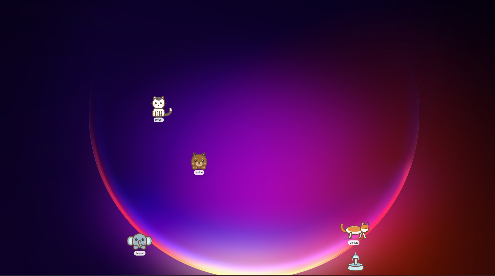
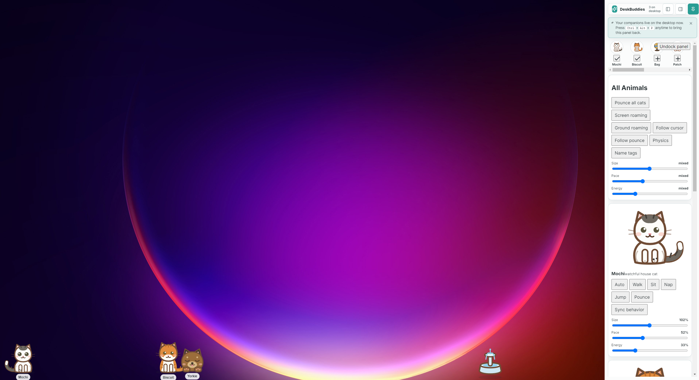
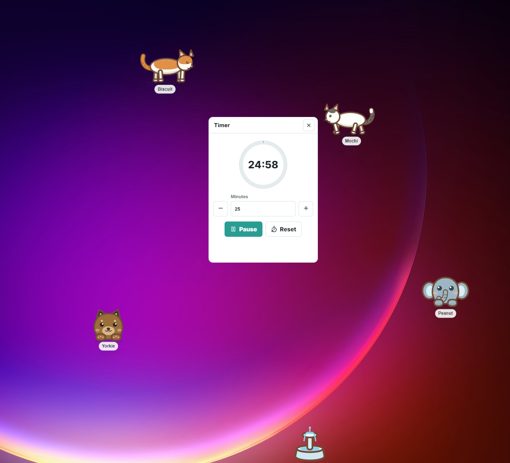

# DeskBuddies 🐱

Desktop companions that live on your screen — roaming your desktop, napping
on the taskbar, and occasionally causing trouble.

Mochi (a calico watch cat) and Biscuit (a tuxedo lounger) are two hand-drawn
cats that wander a transparent overlay across your entire desktop. They walk,
sit, nap, stretch, watch your cursor, and sometimes zoom across the screen for
no reason. Plus a whole catalog of bonus companions — dogs, capybaras, tiny
elephants, raccoons, and a few weird ones — to summon and customize.



## Why?

I wanted a desktop pet that actually felt alive — not a static sprite that
sits in the corner, but something that wanders, reacts, and has a bit of
personality. Most desktop pet apps I found were either abandoned Java applets
from 2004 or bloated Electron apps with a million dependencies and no soul.

So I built one. It's cats (and a few other critters) for now, but the avatar
system is extensible — adding a new companion is just a matter of drawing an
SVG and adding a profile.

## Features

### Companions

- **Two starter cats** — Mochi (calico, watchful — stares at your cursor a
  lot) and Biscuit (tuxedo, lazy — naps whenever possible). Custom SVG rigs,
  no image assets.
- **8 catalog companions** — summon a Yorkie terrier, a capybara named Capy,
  a tiny elephant named Peanut, a raccoon named Bandit, a blue blob monster
  named Sprout, a patch cat, a keyboard buddy, and a punching bag (it's a
  training thing). All custom SVG.
- **Articulated walk cycle** — side-profile CatWalkRig with leg swing, tail
  sway, and ear twitch. Pure CSS keyframes, no game engine.

### Interactions

- **Click to pet** — click a companion to give it a heart reaction. Drag to
  reposition.
- **Drag-and-spawn** — pull companions from the rail onto the desktop. Hide
  and show from the tray.
- **Companion bonding** — Mochi and Biscuit cuddle when they're both resting
  nearby. Biscuit wanders over to the water fountain for a drink.
- **Follow mode** — all companions follow your cursor around the screen.
- **Pounce mode** — all companions pounce in unison. Because chaos.

### Control Panel



- **Per-companion controls** — size, pace, energy, and personality weight
  sliders with live updates. Force behaviors (auto, walk, sit, nap, jump,
  pounce) on individual companions.
- **Group controls** — "All Animals" panel with one-click toggles: pounce
  all, screen roaming, ground roaming, follow cursor, physics, name tags.
  Global size/pace/energy sliders.
- **System tray integration** — dock the panel to the tray. Press
  `Ctrl+Alt+P` to bring it back.

### Tools



- **Focus timer** — Pomodoro-style timer with a 25-minute default. Runs while
  your companions keep you company. Pause, reset, adjust minutes.
- **Task list** — simple checklist built into the timer tool.

### Behavior Engine

Each companion has its own personality profile — weighted probabilities for
idle, walk, sit, nap, stretch, watch, jump, and wander behaviors. Mochi
watches more. Biscuit naps more. The capybara is just chill. Behaviors are
weighted-random, so no two sessions look the same.

### Overlay

- **Transparent, click-through, always-on-top** — companions roam behind your
  windows without intercepting clicks.
- **Fountain prop** — a little water fountain sticker. Biscuit visits it
  periodically for a drink.
- **Multi-monitor aware** — overlay covers the primary display (multi-monitor
  roaming is in progress).

## Screenshots

| Desktop Overlay | Control Panel | Timer Tool |
|:---:|:---:|:---:|
|  |  |  |

### Video Demo

See it in motion:

[](docs/screenshots/demo.mp4)

## Tech Stack

- Electron 32 + Vite 5 + React 18
- TypeScript throughout (strict mode)
- Vitest for unit tests (100+ tests across engine, components, and overlay logic)
- Pure CSS animations — no canvas, no WebGL, no game engine, no Three.js
- Custom SVG cat rigs with articulated limbs

## Build

```bash
npm install
npm run build   # type-check + vite build
npm run dist    # build + electron-builder (NSIS installer + portable exe)
```

Requires Node 18+ and npm. For Windows portable/NSIS builds on Linux or macOS,
Wine is needed (electron-builder handles this automatically).

## Development

```bash
npm run dev      # starts vite dev server + electron
npm test         # run vitest (100+ tests)
```

## Project Structure

```
electron/             Electron main + preload + window management
  main.cjs             Main process, tray, window creation
  preload.cjs          IPC bridge
  overlayBounds.cjs    Multi-monitor overlay sizing
  panelDocking.cjs     Panel dock/undock logic
src/
  avatars/             SVG companion rigs (CatWalkRig, Fountain)
  components/           React UI (control cards, rail, tool drawer, timer)
  overlay/              Overlay logic (companion sim, hit testing, bounds)
  shared/               IPC bridge between panel and overlay
  App.tsx               Main app shell (tray, panel rendering)
  data.ts               Companion profiles and catalog (10 companions)
  behaviorEngine.ts     Weighted behavior state machine
  types.ts              Shared TypeScript types
```

## Companions

| Name | Species | Description |
|------|---------|-------------|
| Mochi | Calico cat | Watchful, stares at your cursor, prefers sitting |
| Biscuit | Tuxedo cat | Lazy lounger, naps constantly, visits the fountain |
| Yorkie | Yorkshire Terrier | Small and alert, medium energy |
| Capy | Capybara | Maximum chill, minimum movement |
| Peanut | Tiny elephant | Gentle giant, slow walker |
| Bandit | Raccoon | Curious and quick, likes to roam |
| Sprout | Blue monster | High energy, bouncy, chaotic |
| Patch | Patch cat | Spotted and easygoing |
| Keys | Keyboard buddy | Lives near your hands, follows typing rhythm |
| Bag | Punching bag | Training dummy. It just stands there. |

## Contributing

PRs welcome! The easiest way to add a new companion:

1. Draw an SVG rig in `src/avatars/` (look at CatWalkRig for the pattern).
2. Add a profile to `src/data.ts` — the catalog companions show the shape.
3. Set personality weights (idleWeight, walkWeight, sitWeight, etc.) in the
   profile.
4. Add tests for any new behavior or interaction.

## License

MIT — see [LICENSE](LICENSE)

## Known Issues

- On some Linux window managers the transparent overlay doesn't render
  correctly. Works on Windows 10/11 and macOS.
- Multi-monitor setups: pets stay on the primary monitor for now. Working on it.
- The fountain position resets on app restart.
- Companion positions reset on app restart (persistence is per-session via
  localStorage, not on-disk).
